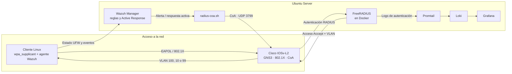

# NAC Zero Trust

**Control de acceso a la red con 802.1X, verificación de postura y contención automatizada.**

> Trabajo de Fin de Máster · Ciberseguridad en Entornos de la Tecnología de la Información · **10/10**  
> **Estado:** laboratorio académico virtualizado; no es una guía de despliegue directo en producción.

## Resumen

Las credenciales válidas no garantizan que un dispositivo conectado siga siendo seguro. Este proyecto implementa un laboratorio de **Network Access Control (NAC)** que combina autenticación, segmentación dinámica, comprobación de la postura del endpoint, monitorización y respuesta automatizada.

El objetivo es demostrar un flujo de defensa de extremo a extremo: detectar que un dispositivo deja de cumplir una condición de seguridad y ordenar al switch que lo traslade a una VLAN de cuarentena.

## Arquitectura

El entorno se desplegó con VMware y GNS3. El switch Cisco emulado actúa como autenticador 802.1X; el cliente Linux utiliza `wpa_supplicant` y Wazuh; el servidor Ubuntu aloja la autenticación, monitorización y respuesta.

## Flujo de seguridad

1. **Autenticación.** El switch consulta a FreeRADIUS y aplica la VLAN indicada en los atributos de autorización.
2. **Postura del endpoint.** El agente Wazuh comprueba el estado de UFW cada 60 segundos. La regla personalizada `100100` alerta cuando detecta que el firewall está inactivo.
3. **Contención.** La respuesta activa ejecuta `radius-coa.sh`, que envía un Change of Authorization (CoA) para mover el puerto del cliente a la VLAN 99.
4. **Observabilidad.** Promtail recoge registros de FreeRADIUS y del sistema; Loki los almacena y Grafana permite consultar los eventos.

| VLAN | Finalidad |
|---|---|
| `100` | Corporativa |
| `10` | Invitados |
| `99` | Cuarentena |

## Pruebas y resultados

- Autenticación 802.1X validada y asignación dinámica de la VLAN corporativa.
- Desactivación controlada de UFW detectada por Wazuh y generación de la alerta de postura.
- Envío de CoA y comprobación del cambio del puerto del cliente a la VLAN 99.
- Simulación de **20 intentos RADIUS fallidos** con `radtest`: los `Access-Reject` quedaron registrados y visibles en Grafana; se documentó también la detección por umbral y el aislamiento automático. Para permitir la prueba, el puerto pasó temporalmente a la VLAN 10 y después se restauró la cuarentena.
- Validación de eventos `Access-Accept` y del contador de autenticaciones correctas.
- Reinicio automático del contenedor FreeRADIUS tras una parada simulada.
- Pruebas de reglas `iptables` para bloquear tráfico no autorizado y permitir las comunicaciones necesarias.
- Acceso SSH con clave pública y código OTP, y medidas de hardening del servidor.

Los resultados corresponden al laboratorio y escenarios documentados; no implican validación en hardware físico ni garantizan el mismo comportamiento en otras redes.

## Tecnologías

`IEEE 802.1X` · `FreeRADIUS` · `Cisco IOSv-L2` · `GNS3` · `VMware` · `Wazuh` · `Docker` · `Promtail` · `Loki` · `Grafana` · `Ubuntu Server` · `iptables` · `SSH` · `Google Authenticator`

## Seguridad

Proyecto académico para un entorno controlado. No publiques credenciales, secretos RADIUS, claves privadas, semillas OTP, códigos de recuperación ni capturas que los revelen. Las pruebas deben limitarse a sistemas propios o autorizados.

---

**Autor:** Marcos Vicente Amián
